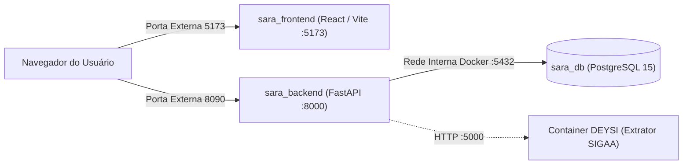

# 🚀 Manual de Implantação em Servidor (Deploy) — Sistema SARA

**Sistema:** SARA — Sistema de Análise e Monitoramento da Retenção Acadêmica (UFC — Campus de Crateús)  
**Stack Tecnológica:** React + Vite (Frontend), Python 3.11 + FastAPI (Backend), PostgreSQL 15 (Banco de Dados), Docker & Docker Compose.

---

## 1. Arquitetura de Containers

O sistema é integralmente containerizado via **Docker Compose** e dividido em 3 serviços principais (além da comunicação opcional com o serviço extrator **DEYSI**):



---

## 2. Mapeamento de Portas (Livre de Conflitos)

As portas externas foram configuradas especificamente para **não colidir** com as portas já em uso no servidor (`8000`, `8001`, `8081`, `8082`, `8083`, `8100`, `8501`, `15672`):

| Serviço | Nome do Container | Porta Interna (Container) | Porta Externa (Host/Servidor) | Variável no `.env` | Finalidade |
| :--- | :--- | :---: | :---: | :--- | :--- |
| **Frontend Web** | `sara_frontend` | `5173` | **`5173`** | `FRONTEND_PORT` | Interface web acessada pelos usuários |
| **Backend API** | `sara_backend` | `8000` | **`8090`** | `BACKEND_PORT` | API REST (FastAPI) consumida pelo navegador |
| **Banco de Dados** | `sara_db` | `5432` | **`5433`** | `DB_EXTERNAL_PORT` | PostgreSQL 15 (persistido no volume `postgres_data`) |
| **Extrator DEYSI** *(opcional)* | `daisy_app` | `5000` | **`5000`** *(ou rede Docker)* | `DAISY_API_URL` | Serviço de raspagem de dados do SIGAA |

> [!TIP]
> Caso o administrador do servidor utilize proxy reverso (**Nginx / Traefik / Caddy**) ou deseje alterar qualquer porta externa, basta modificar `BACKEND_PORT`, `FRONTEND_PORT` ou `DB_EXTERNAL_PORT` diretamente no arquivo `.env`, sem necessidade de alterar o `docker-compose.yml` ou os `Dockerfile`s.

---

## 3. Pré-requisitos no Servidor

- **Docker Engine** (20.10+)
- **Docker Compose** (v2+)
- **Git**

---

## 4. Configuração das Variáveis de Ambiente (`.env`)

Por segurança (e conformidade com a LGPD), o arquivo `.env` **não está versionado no Git**. Antes de subir os containers, crie um arquivo chamado **`.env`** na raiz do projeto (mesma pasta do `docker-compose.yml`) com o seguinte conteúdo:

```env
# ==========================================
# 1. BANCO DE DADOS (PostgreSQL)
# ==========================================
DB_USER=postgres
DB_PASSWORD=DEFINA_UMA_SENHA_FORTE_AQUI
DB_HOST=db
DB_PORT=5432
DB_NAME=sara

# ==========================================
# 2. SEGURANÇA E AUTENTICAÇÃO (JWT)
# ==========================================
# Gere uma chave aleatória (ex: openssl rand -urlsafe 32)
JWT_SECRET_KEY=DEFINA_UMA_CHAVE_SECRETA_ALEATORIA_AQUI
ACCESS_TOKEN_EXPIRE_MINUTES=15
REFRESH_TOKEN_DAYS=7

# ==========================================
# 3. PORTAS E ENDEREÇOS DO SERVIDOR
# ==========================================
BACKEND_PORT=8090
FRONTEND_PORT=5173
DB_EXTERNAL_PORT=5433

# IMPORTANTE: Substitua SEU_IP_OU_DOMINIO pelo IP público ou domínio real do servidor!
ALLOW_ORIGINS=http://SEU_IP_OU_DOMINIO:5173,http://localhost:5173
VITE_URL_API=http://SEU_IP_OU_DOMINIO:8090

# (Opcional) URL do container DEYSI caso esteja rodando no servidor
DAISY_API_URL=http://172.18.0.1:5000

# ==========================================
# 4. USUÁRIOS PADRÃO (Criados automaticamente no 1º boot)
# ==========================================
# Perfil 1: Administrador (Acesso total + tela de Importação de Dados)
ADMIN_NOME=Administrador SARA
ADMIN_EMAIL=admin@crateus.ufc.br
ADMIN_SENHA=DEFINA_A_SENHA_DO_ADMIN

# Perfil 2: Consulta Acadêmica / Usuário Comum (Visualização de gráficos e relatórios)
USUARIO_NOME=Consulta Acadêmica
USUARIO_EMAIL=usuario@crateus.ufc.br
USUARIO_SENHA=DEFINA_A_SENHA_DO_USUARIO
```

> [!IMPORTANT]
> **Atenção aos campos `ALLOW_ORIGINS` e `VITE_URL_API`:**  
> Como o navegador do usuário faz requisições diretamente para a API do Backend, `VITE_URL_API` deve conter o **IP público ou domínio do servidor** (ex: `http://200.129.xx.xx:8090` ou `https://sara.crateus.ufc.br/api`), e `ALLOW_ORIGINS` deve conter a URL de onde o Frontend é acessado (ex: `http://200.129.xx.xx:5173`).

---

## 5. Passo a Passo para Subir a Aplicação

### Passo 1: Clonar o repositório
```bash
git clone <URL_DO_REPOSITORIO_GIT> sara
cd sara
```

### Passo 2: Criar o arquivo `.env`
```bash
nano .env
# Cole o conteúdo da Seção 4 acima, ajustando as senhas e o IP/domínio do servidor
```

### Passo 3: Construir e iniciar os containers em background
```bash
docker compose up -d --build
```

### Passo 4: Verificar se os 3 containers estão rodando
```bash
docker compose ps
```
Saída esperada:
- `sara_db` — `Up` (`0.0.0.0:5433->5432/tcp`)
- `sara_backend` — `Up` (`0.0.0.0:8090->8000/tcp`)
- `sara_frontend` — `Up` (`0.0.0.0:5173->5173/tcp`)

---

## 6. Inicialização Automática do Banco e Usuários

Não é necessário rodar scripts manuais de criação de tabelas ou cadastro de usuários:
1. No momento em que o container `sara_backend` inicia, ele cria automaticamente todas as tabelas necessárias no PostgreSQL (`curso`, `disciplina`, `aluno`, `historico_disciplina`, `usuario`).
2. Em seguida, ele sincroniza automaticamente os **2 usuários configurados no `.env`**:
   - **`ADMIN_EMAIL`**: Criado com perfil administrativo (único perfil com acesso à tela `/importacao` e às rotas `/api/admin/*`).
   - **`USUARIO_EMAIL`**: Criado com perfil de consulta (acesso ao Dashboard, Alunos, Perfil do Aluno, Disciplinas e exportação de relatórios PDF/CSV).
3. O cadastro público (`/api/auth/registrar`) encontra-se **bloqueado** para acessos não autenticados.

---

## 7. Comandos Úteis de Manutenção e Backup

### Visualizar logs em tempo real
```bash
docker compose logs -f backend
docker compose logs -f frontend
```

### Reiniciar após alteração no `.env`
```bash
docker compose up -d --force-recreate
```

### Realizar backup do banco de dados PostgreSQL
```bash
docker exec -t sara_db pg_dump -U postgres sara > backup_sara_$(date +%Y%m%d).sql
```

### Restaurar backup do banco de dados
```bash
cat backup_sara.sql | docker exec -i sara_db psql -U postgres -d sara
```
